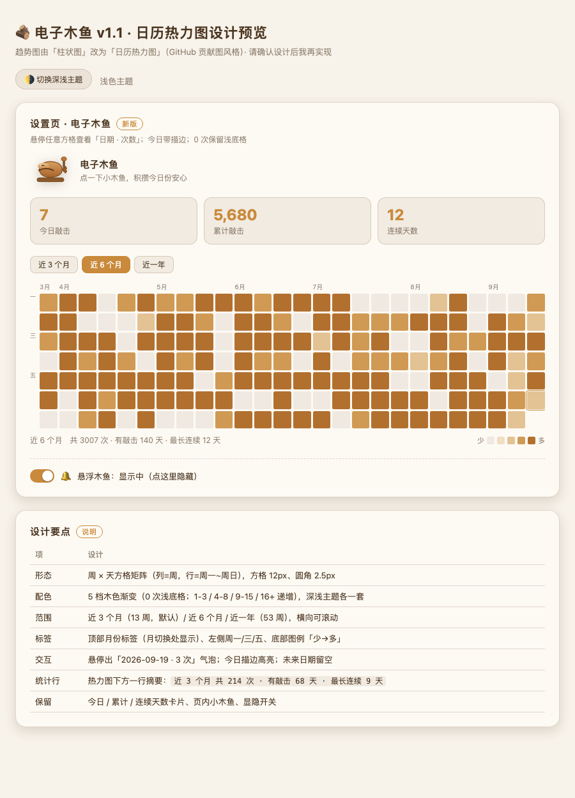

# 🪵 Wooden Fish Pet · 电子木鱼桌宠 (for DeepSeek Harness)

> A clickable **wooden-fish desktop pet** for the [DeepSeek Harness](https://github.com/deepseek-ai/deepseek-harness) web GUI.
> Not a cartoon mascot — a zen digital 木鱼 you can knock anytime. Every knock is counted per day, and the settings page shows your daily trend.

[中文说明](README.zh.md)

---

## ✨ Features

- **Floating wooden fish** on the page — drag it anywhere, click to knock
- Knock feedback: fish shake + mallet swing + ripple ring + floating "+1"
- Hover the fish to see **今天已敲 N 次** (today's count)
- **Per-day counting** (`YYYY-MM-DD` buckets), persisted to `$DSH_HOME/wooden-fish-data.json` — survives restarts
- **Calendar heatmap** in settings (`设置 → 电子木鱼`): 3 / **6 (default)** / 12-month ranges on a 5-level wood ramp, month + weekday labels, hover for details, today outlined — above today / total / streak cards
- **Remembers your setup** — fish position and show/hide state persist across reloads
- **Follows your theme** — chrome uses the harness theme tokens (`--dsw-alias-*`), so it matches light/dark and custom themes (e.g. sakura); the fish and heat ramp keep their wood identity
- **Scrollbar-free responsive heatmap** — cells share the panel width equally (larger for short ranges, compact for the 1-year view)
- Zen wood style, zero network calls, data stays local

> ⚠️ No knock **sound** yet — feedback is visual only.

## 📸 Preview



Interactive demo: [docs/preview-heatmap.html](docs/preview-heatmap.html) (open in a browser — drag and knock the fish, switch the heatmap range)

## 📦 Install

The plugin is an installable **web-profile bundle** package. From the DeepSeek Harness checkout:

```bash
dsh plugin --profile web add --config.minimumReleaseAge=0 -w <this-repo-path>
# then restart dsh
```

Or install directly from GitHub:

```bash
dsh plugin --profile web add --config.minimumReleaseAge=0 -w github:ShenpingDD/dsh-wooden-fish
# then restart dsh
```

After restart the fish appears at the bottom-right automatically. **No re-activation needed on later restarts.**

## 🎮 Usage

| Action | Effect |
|---|---|
| Click the fish | Knock: +1 to today's count, animation feedback |
| Drag the fish | Move it anywhere (the position is remembered) |
| Hover the fish | Show today's count bubble |
| 设置 → 电子木鱼 | Stats cards + calendar heatmap (3 / 6 / 12 months) |
| Toggle in settings | Show/hide the floating fish (a "restore" pill appears while hidden; the choice persists) |

## 💾 Data

Stored at `$DSH_HOME/wooden-fish-data.json`:

```json
{ "version": 1, "days": { "2026-08-18": 10, "2026-08-19": 3 } }
```

- `$DSH_HOME` is the harness data home (default `~/.dsh`)
- Local-only, plain JSON, easy to back up or reset
- See [docs/sample-data.json](docs/sample-data.json) for a fuller example

## 🧱 How it works

| Half | Mechanism |
|---|---|
| **Host** (`lib/index.js`) | Registers JSON routes on the harness `webServer` (`POST /muyu/knock`, `GET /muyu/summary`, `POST /muyu/client-hello`) and persists via `node:fs`. Must declare a non-empty `inject` (`['webServer']`) — an empty list applies before services are ready and `ctx.get()` returns `undefined` for everything. |
| **Client** (`lib/client.js`) | A web `ModuleLoader` bundle (`window.__ModuleLoader__.load(...)`) that renders the fish in the `shell.overlay` slot and the heatmap page in `settings.section`, talking to the host over same-origin `fetch`. **On DSH 0.1.5 `dsh.client.inject` must name ids that actually exist** (`@deepseek-ai/dsh-client-ui-renderer` provides `slots`); an unsatisfiable id leaves the entry waiting forever and the UI silently never mounts. |

More: [ARCHITECTURE.md](ARCHITECTURE.md)

## 📚 Docs

- [docs/PRD.md](docs/PRD.md) — product requirements (zh)
- [docs/UI-DESIGN.md](docs/UI-DESIGN.md) — design spec: tokens, states, animations (zh)
- [docs/wooden-fish-preview.html](docs/wooden-fish-preview.html) — interactive UI preview (open in a browser)
- [docs/fish.svg](docs/fish.svg) — the fish artwork
- [CHANGELOG.md](CHANGELOG.md) · [DEVELOPMENT.md](DEVELOPMENT.md) · [SECURITY.md](SECURITY.md) · [CONTRIBUTING.md](CONTRIBUTING.md)

## ⚖️ License

[MIT](LICENSE)
