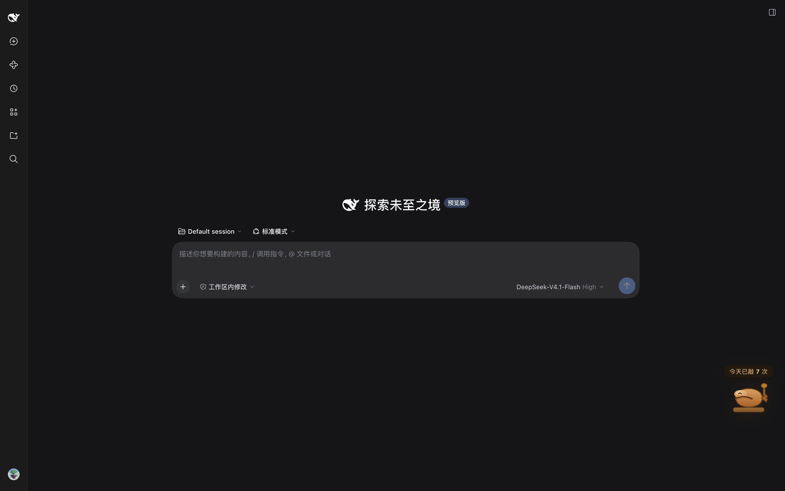
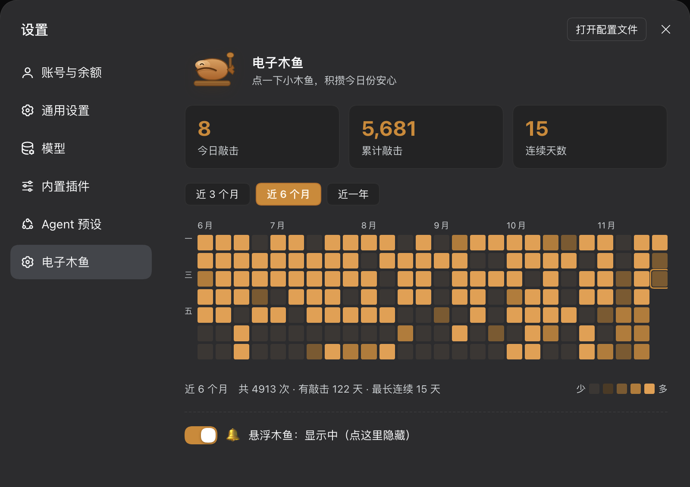
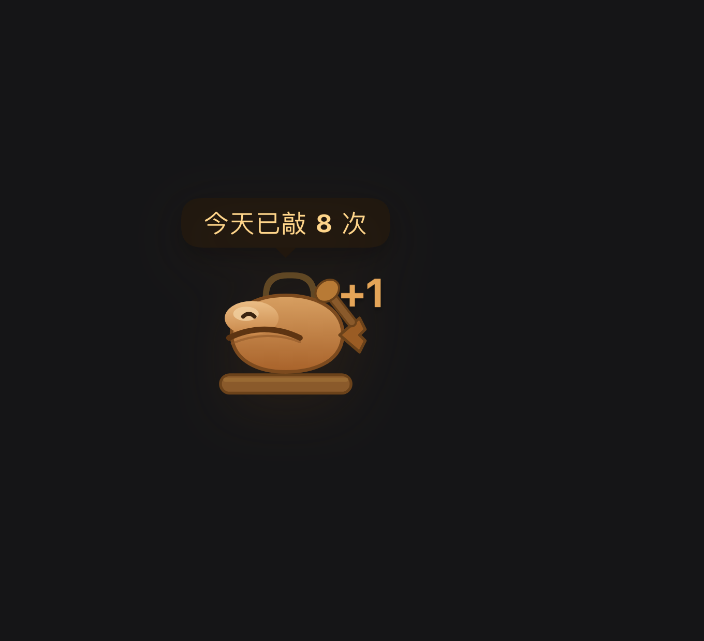

# 🪵 dsh-wooden-fish · 电子木鱼桌宠 — a DeepSeek Harness plugin

<p>
  <a href="https://github.com/ShenpingDD/dsh-wooden-fish/releases/latest"></a>
  <a href="LICENSE"></a>
  <a href="package.json"></a>
  <a href="https://awesome-dsh-plugin.com/p/ShenpingDD/dsh-wooden-fish/"></a>
</p>

> A clickable **electronic wooden fish (木鱼)** living on your chat surface in [DeepSeek Harness](https://github.com/deepseek-ai/deepseek-harness). Knock it when you need a moment of zen — every knock is counted per day, and a calendar heatmap in Settings shows how your practice is going.
>
> Local-only, zero network calls, no cartoon mascots — just one small piece of wood on your desk.

[中文说明](README.zh.md) · [Changelog](CHANGELOG.md) · [Architecture](ARCHITECTURE.md) · [Development](DEVELOPMENT.md)



## 🧩 What this is

This repository is a **DeepSeek Harness (DSH) plugin**, not a standalone app. It ships as a *web profile bundle* package — a single npm-style package that DSH installs into one of its profiles and loads on every start.

DSH is the harness behind the DeepSeek Harness desktop app and its web GUI. Its UI is assembled from *slots* that plugins can fill, so installing this package adds exactly two things to the interface you already use:

| Half | What it adds | Where it lives |
|---|---|---|
| **Client** | The floating wooden fish, and its settings page | the `shell.overlay` and `settings.section` UI slots |
| **Host** | Counting, persistence and a tiny JSON API | three `/muyu/*` routes on the harness `webServer` |

Nothing else is touched: no new window, no separate server, no background daemon. Uninstall the package and both halves disappear with it.

> Needs a working DSH installation (0.2.2-rc.5 is what this release is verified on). If you do not run DSH yet, install that first — this package will not do anything on its own.

## 🚀 Quick start

Listed in the [awesome-dsh-plugin](https://awesome-dsh-plugin.com/p/ShenpingDD/dsh-wooden-fish/) registry, so the plugin market inside DSH Desktop can install it directly. From a terminal:

```bash
# prebuilt tarball — no build approval, no build step
dsh plugin --profile web add https://github.com/ShenpingDD/dsh-wooden-fish/releases/latest/download/dsh-wooden-fish.tgz

# or from source (GitHub-sourced installs need one allowBuilds approval)
dsh plugin --profile web add --config.minimumReleaseAge=0 -w github:ShenpingDD/dsh-wooden-fish

# then restart dsh — the fish shows up at the bottom-right
```

Install into the profile you actually run (the Desktop app manages its own profile; `web` is the usual CLI one). To remove it again: `dsh plugin --profile web remove dsh-wooden-fish`.

Installing from a local checkout works the same way — pass the repo path instead of `github:…`.

## ✨ Features

**The fish**

- Floating on the page and draggable anywhere; click to knock
- Knock feedback: fish shake + mallet swing + ripple ring + floating `+1`
- Hover to see **今天已敲 N 次** (today's count)
- Position and show/hide state are remembered across reloads

**The practice**

- **Per-day counting** in `YYYY-MM-DD` buckets, persisted to `$DSH_HOME/wooden-fish-data.json` — survives restarts
- **Calendar heatmap** (`设置 → 电子木鱼`): 3 / **6 (default)** / 12-month ranges on a 5-level wood ramp, month + weekday labels, hover for exact counts, today outlined, summary above
- Today / total / streak cards

**The fit**

- Covers the harness chrome with theme tokens (`--dsw-alias-*`), so it follows light, dark and custom themes; the fish and the wood ramp keep their own palette
- Scrollbar-free responsive heatmap — cells share the panel width equally (bigger on short ranges, compact for the 1-year view)
- Host half makes no network calls; your data never leaves the machine

> ⚠️ No knock **sound** yet — feedback is visual only.

## 📸 Screenshots

Real captures from DeepSeek Harness 0.2.2-rc.5 (not mockups):

| Floating pet on the chat surface | Settings · calendar heatmap |
| --- | --- |
|  |  |

Knock feedback — mallet swing, ripple ring, floating `+1`:



Interactive demo: open [docs/preview-heatmap.html](docs/preview-heatmap.html) in a browser — drag the fish, knock it, switch the heatmap range.

## 🎮 Usage

| Action | Effect |
|---|---|
| Click the fish | Knock: +1 to today's count, animation feedback |
| Drag the fish | Move it anywhere (the position is remembered) |
| Hover the fish | Show today's count bubble |
| 设置 → 电子木鱼 | Stats cards + calendar heatmap (3 / 6 / 12 months) |
| Toggle in settings | Show/hide the floating fish (a "restore" pill appears while hidden; the choice persists) |

## 💾 Data & privacy

Stored at `$DSH_HOME/wooden-fish-data.json` (default `~/.dsh`):

```json
{ "version": 1, "days": { "2026-08-18": 10, "2026-08-19": 3 } }
```

- Plain local JSON — easy to back up, inspect or reset
- No telemetry and no network requests; the client only talks to its own host over same-origin `/muyu/*` routes
- A fuller example lives in [docs/sample-data.json](docs/sample-data.json)

## 🧱 Compatibility

| | |
|---|---|
| DSH | `>=0.2.2-rc.1 <0.3.0-0`; verified end-to-end on **0.2.2-rc.5** (host routes, bundled client, overlay + settings mounting, persistence) |
| Node | `>=20` |
| Profile | any DSH profile you run (a *web profile bundle*: install it into the profile that hosts your GUI) |
| Renamed | This plugin used to be published as `wooden-fish-dsh`. The data file and the `/muyu/*` routes are unchanged, so existing counts carry over — see [CHANGELOG](CHANGELOG.md) |

## 🛠 How it works

| Half | Mechanism |
|---|---|
| **Host** (`lib/index.js`) | Registers JSON routes on the harness `webServer` (`POST /muyu/knock`, `GET /muyu/summary`, `POST /muyu/client-hello`) and persists with `node:fs` (debounced writes). It must declare a non-empty `inject` (`['webServer']`) — an empty list applies before services are ready and `ctx.get()` returns `undefined` for everything. |
| **Client** (`lib/client.js`) | A web `ModuleLoader` bundle (`window.__ModuleLoader__.load(...)`) that renders the fish in the `shell.overlay` slot and the heatmap page in `settings.section`, talking to the host over same-origin `fetch`. `dsh.client.inject` must name ids that actually exist (`@deepseek-ai/dsh-client-ui-renderer` provides `slots`); an unsatisfiable id leaves the entry waiting forever and the UI silently never mounts. |

The single patched entry lives in [cordis.patch.yml](cordis.patch.yml) (`id: dsh-wooden-fish`); `package.json` declares `dsh.bundle.patch` so the harness picks it up. More detail, including slot and theming rules: [ARCHITECTURE.md](ARCHITECTURE.md).

## 📚 Docs

- [docs/PRD.md](docs/PRD.md) — product requirements (zh)
- [docs/UI-DESIGN.md](docs/UI-DESIGN.md) — design spec: tokens, states, animation parameters (zh)
- [docs/wooden-fish-preview.html](docs/wooden-fish-preview.html) — original interactive UI preview
- [docs/fish.svg](docs/fish.svg) — the fish artwork
- [CHANGELOG.md](CHANGELOG.md) · [DEVELOPMENT.md](DEVELOPMENT.md) · [CONTRIBUTING.md](CONTRIBUTING.md) · [SECURITY.md](SECURITY.md)

## ⚖️ License

[MIT](LICENSE)
