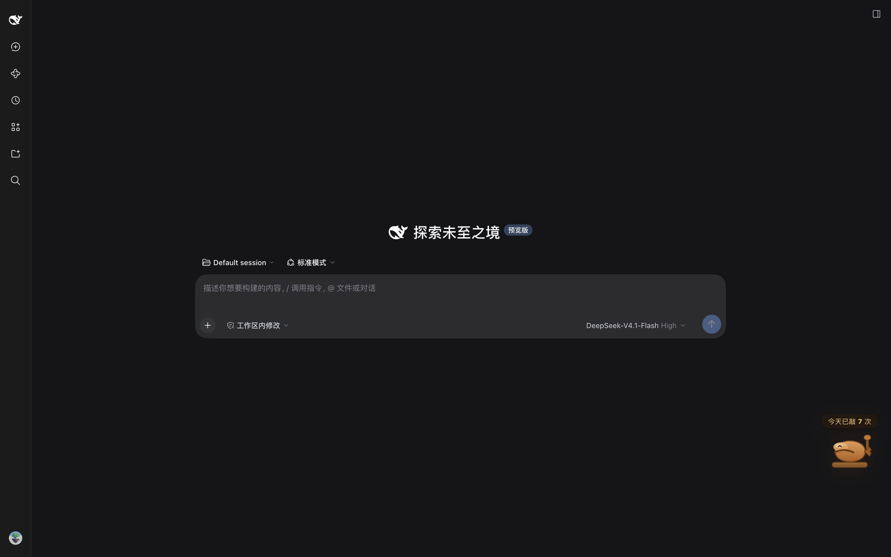
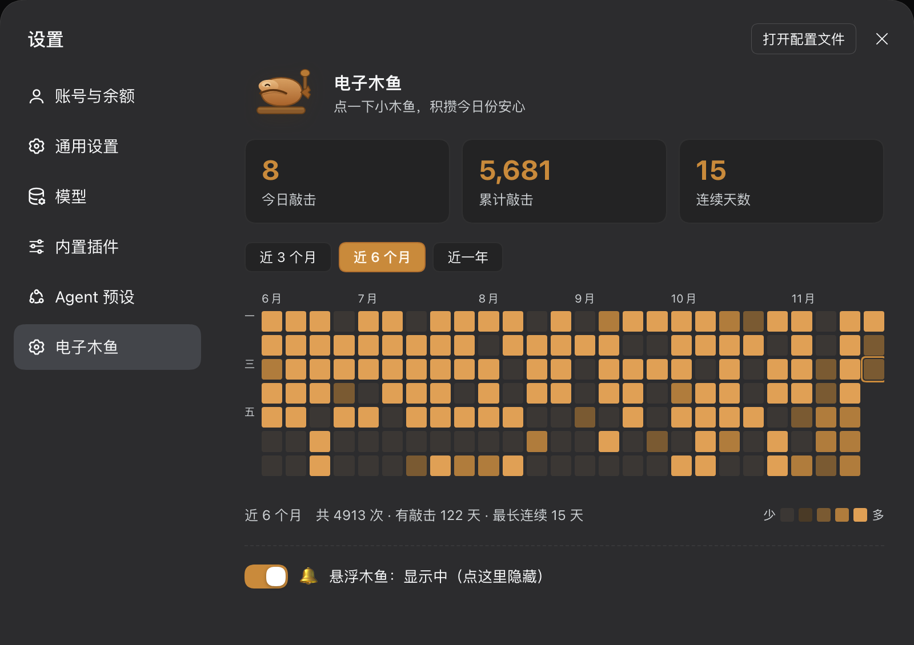
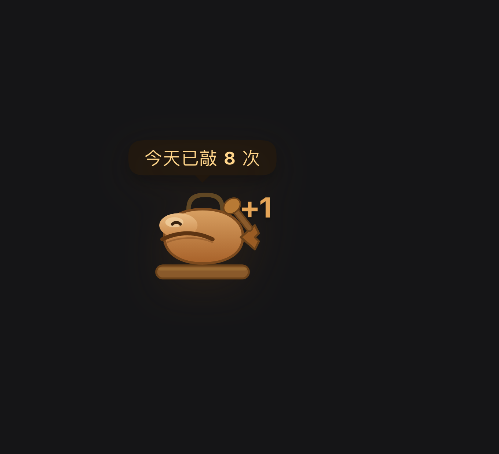

# 🪵 dsh-wooden-fish · 电子木鱼桌宠 —— DeepSeek Harness 插件

<p>
  <a href="https://github.com/ShenpingDD/dsh-wooden-fish/releases/latest"></a>
  <a href="LICENSE"></a>
  <a href="package.json"></a>
  <a href="https://awesome-dsh-plugin.com/p/ShenpingDD/dsh-wooden-fish/"></a>
</p>

> 一只长在 [DeepSeek Harness](https://github.com/deepseek-ai/deepseek-harness) 对话界面上的可点击「电子木鱼」。想静一下的时候就敲它——每次敲击按天计数，设置页里的日历热力图能看到自己的修行轨迹。
>
> 纯本地、零网络请求，不是卡通吉祥物，只是案头的一件小木器。

[English](README.md) · [更新日志](CHANGELOG.md) · [架构说明](ARCHITECTURE.md) · [开发文档](DEVELOPMENT.md)



## 🧩 这是什么

这个仓库是一个 **DeepSeek Harness（DSH）插件**，不是独立应用。它以 *web profile bundle* 的形式发布——一个普通的 npm 包，由 DSH 装进某个 profile，并在每次启动时加载。

DSH 是 DeepSeek Harness 桌面端与其 Web 界面背后的宿主框架，界面由一个个可被插件填充的**槽位（slot）**拼成。装上这个包，只是往你已经在用的界面里加了两样东西：

| 半端 | 加了什么 | 落在哪里 |
|---|---|---|
| **客户端** | 悬浮木鱼，以及它的设置页 | `shell.overlay` 与 `settings.section` 两个 UI 槽位 |
| **宿主端** | 计数、持久化与一个极小的 JSON API | 宿主 `webServer` 上的三个 `/muyu/*` 路由 |

除此之外不碰任何东西：不开新窗口、不起独立服务、不驻留后台进程。卸载这个包，两半一起消失。

> 前提是你已经有一个可用的 DSH 环境（本次发布验证在 0.2.2-rc.5）。还没装 DSH 的话请先装它——单独装这个包不会有任何效果。

## 🚀 快速开始

本插件已收录于 [awesome-dsh-plugin](https://awesome-dsh-plugin.com/p/ShenpingDD/dsh-wooden-fish/) 注册表，DSH 桌面端内置的插件市场可以直接搜到并安装。命令行方式：

```bash
# 装预构建 tarball——无需构建授权、无构建步骤
dsh plugin --profile web add https://github.com/ShenpingDD/dsh-wooden-fish/releases/latest/download/dsh-wooden-fish.tgz

# 或从源码安装（GitHub 源码安装需要一次 allowBuilds 授权）
dsh plugin --profile web add --config.minimumReleaseAge=0 -w github:ShenpingDD/dsh-wooden-fish

# 然后重启 dsh —— 木鱼出现在右下角
```

请装进你实际在跑的那个 profile（桌面端由应用自己管理 profile，`web` 是命令行常用的那个）。卸载：`dsh plugin --profile web remove dsh-wooden-fish`。

从本地检出目录安装同理，把 `github:…` 换成仓库路径即可。

## ✨ 功能

**这只木鱼**

- 悬浮在页面上，可拖到任意位置，点击即敲
- 敲击反馈：木鱼晃动 + 木槌朝左敲落 + 声波涟漪环 + 「+1」飘字
- 悬停木鱼显示「今天已敲 N 次」
- 位置与显隐状态刷新后依然记得

**这项修行**

- **按天计数**（`YYYY-MM-DD` 分桶），持久化到 `$DSH_HOME/wooden-fish-data.json`，重启不丢
- **日历热力图**（`设置 → 电子木鱼`）：近 3 / **6（默认）** / 12 个月，5 档木色、月份 + 星期标签、悬停看精确数值、今日描边，上方是范围摘要
- 今日 / 累计 / 连续天数三张卡片

**这点贴合**

- 外壳使用 harness 主题 token（`--dsw-alias-*`），自动跟随浅色、深色与自定义主题；木鱼与热力色阶保留木质本色
- 无横向滚动条的自适应热力图：格子等分占满容器宽度（短范围更大，一年视图自动压缩）
- 宿主端不发网络请求，数据不出本机

> ⚠️ 暂无敲击音效，反馈以视觉为主。

## 📸 界面预览

以下均为 DeepSeek Harness 0.2.2-rc.5 上的实机截图（非效果图）：

| 桌面悬浮木鱼 | 设置页 · 日历热力图 |
| --- | --- |
|  |  |

敲击反馈——木槌挥动、涟漪、飘起的 `+1`：



交互演示：浏览器打开 [docs/preview-heatmap.html](docs/preview-heatmap.html)——可拖动、敲击木鱼、切换热力图范围。

## 🎮 使用

| 操作 | 效果 |
|---|---|
| 点击木鱼 | 敲击一次：今日 +1，播放敲击动画 |
| 拖动木鱼 | 移动到任意位置（位置会被记住） |
| 悬停木鱼 | 显示「今天已敲 N 次」气泡 |
| 设置 → 电子木鱼 | 统计卡片 + 日历热力图（近 3 / 6 / 12 个月） |
| 设置页开关 | 隐藏/显示悬浮木鱼（隐藏后出现恢复药丸，选择会被记住） |

## 💾 数据与隐私

存放于 `$DSH_HOME/wooden-fish-data.json`（默认 `~/.dsh`）：

```json
{ "version": 1, "days": { "2026-08-18": 10, "2026-08-19": 3 } }
```

- 纯本地纯 JSON，方便备份、查看或重置
- 无遥测、无外发请求；客户端只通过同源 `/muyu/*` 路由与自己的宿主通信
- 更完整的示例见 [docs/sample-data.json](docs/sample-data.json)

## 🧱 兼容性

| | |
|---|---|
| DSH | `>=0.2.2-rc.1 <0.3.0-0`；已在 **0.2.2-rc.5** 上端到端实测（宿主路由、客户端 bundle、悬浮层与设置页挂载、持久化） |
| Node | `>=20` |
| Profile | 装进你实际运行的任意 DSH profile（它是 *web profile bundle*，要装在承载 GUI 的那个 profile 里） |
| 改名 | 本插件曾用名 `wooden-fish-dsh`。数据文件与 `/muyu/*` 路由保持不变，原有计数直接沿用——见 [CHANGELOG](CHANGELOG.md) |

## 🛠 工作原理

| 半端 | 机制 |
|---|---|
| **Host**（`lib/index.js`） | 在 harness 的 `webServer` 上注册 JSON 路由（`POST /muyu/knock`、`GET /muyu/summary`、`POST /muyu/client-hello`），用 `node:fs` 防抖写盘。**必须声明非空 `inject`**（`['webServer']`）——空 `inject` 会在服务就绪前 apply，届时 `ctx.get()` 全部返回 undefined。 |
| **Client**（`lib/client.js`） | web `ModuleLoader` bundle（`window.__ModuleLoader__.load(...)`）：在 `shell.overlay` 渲染悬浮木鱼、在 `settings.section` 渲染热力图页，通过同源 `fetch` 与宿主通信。`dsh.client.inject` 必须写真实存在的 id（`@deepseek-ai/dsh-client-ui-renderer` 提供 `slots` 服务）；写了无法满足的 id，entry 会永远等待 → UI 静默不挂载。 |

被 patch 的唯一条目在 [cordis.patch.yml](cordis.patch.yml)（`id: dsh-wooden-fish`），`package.json` 通过 `dsh.bundle.patch` 声明它。槽位与主题规则的更多细节见 [ARCHITECTURE.md](ARCHITECTURE.md)。

## 📚 文档

- [docs/PRD.md](docs/PRD.md) — 产品需求文档
- [docs/UI-DESIGN.md](docs/UI-DESIGN.md) — 设计规格：令牌、状态、动效参数
- [docs/wooden-fish-preview.html](docs/wooden-fish-preview.html) — 最初的交互预览页
- [docs/fish.svg](docs/fish.svg) — 木鱼美术稿
- [CHANGELOG.md](CHANGELOG.md) · [DEVELOPMENT.md](DEVELOPMENT.md) · [CONTRIBUTING.md](CONTRIBUTING.md) · [SECURITY.md](SECURITY.md)

## ⚖️ License

[MIT](LICENSE)
